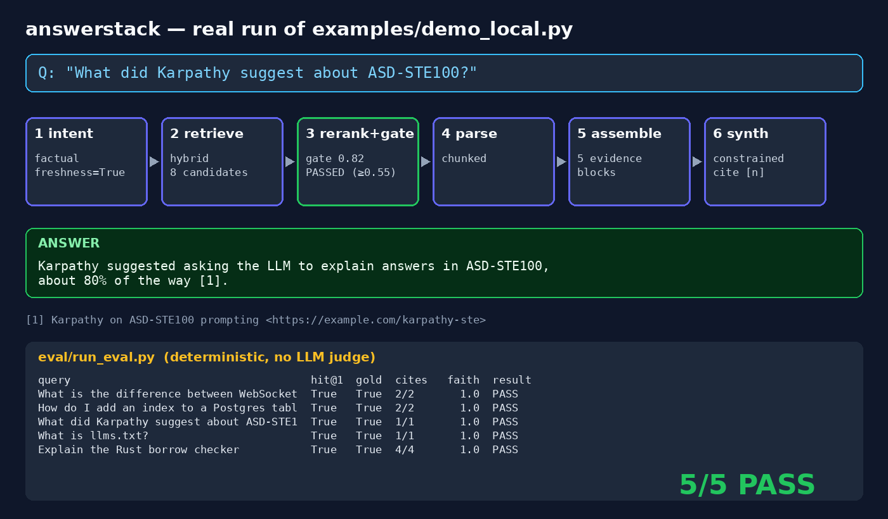

# answerstack



<sub>Real output of `python3 examples/demo_local.py` and `python3 eval/run_eval.py` — raw logs in [docs/](docs/).</sub>

An open-source answer-engine **core**: the pipeline behind AI search products, not another chat UI.

Perplexity's engineering blog describes their engine as intent parsing, hybrid retrieval, multi-stage ranking with a quality gate, content understanding, citation-embedded evidence, and constrained synthesis. Existing open-source clones replicate the *product*; answerstack replicates the *pipeline*, eval-first.

## The 6 stages

```
query -> [1 intent] -> [2 hybrid retrieve] -> [3 cascade rerank + gate + requery]
      -> [4 parse/chunk] -> [5 assemble evidence] -> [6 constrained synth] -> cited answer
```

1. **intent** - factual / comparative / procedural / trending classification; intent-conditioned query rewrite.
2. **retrieval** - hybrid scoring (BM25-lite + ngram overlap). `LocalCorpus` ships built-in; implement `.search(query, k)` to plug SearXNG, Tavily, or your crawler.
3. **rerank** - two-stage cascade (lexical shortlist, then cross-encoder-lite) with a quality gate (~0.55). Below gate: requery once with top-doc signal terms - the fail-safe loop.
4. **parse** - nav/boilerplate stripping + chunking.
5. **assemble** - numbered evidence blocks; citations are pre-embedded in the prompt.
6. **synth** - constrained generation ("use ONLY the evidence, cite [n]"). `MockLLM` is deterministic extractive; `make_openai()` for a real model.

## Quick start (no network, no keys)

```bash
python examples/demo_local.py
```

## Eval

```bash
python eval/run_eval.py
```

Metrics: hit@1 (top cited doc), gold-string recall, citation faithfulness (each claim sentence must overlap its cited chunk >= 0.3 on content tokens). Deterministic - no LLM judge.

Current seed set: 5/5 pass with `MockLLM`.

## Why not just use Vane/Perplexica?

They are excellent self-hosted *products*. Single-shot retrieval, optional rerank, no eval harness. answerstack is a library: every stage is swappable, and the claim is `eval/run_eval.py` output, not a screenshot.

## Roadmap

- [ ] SearXNG + Tavily retrieval backends
- [ ] Real-LLM eval mode (env-keyed)
- [ ] Sequential planning loop (Pro Search style: plan -> per-step queries)
- [ ] Search-as-Code: model-written retrieval pipelines executed in a sandbox (v2)

## License

MIT
